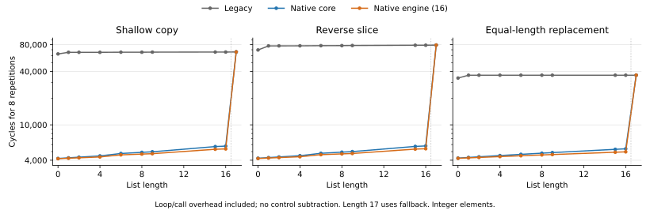

# Short-list acceleration

The native core fast paths remove firmware slice normalization, construction,
and dispatch overhead. `mpy_shortlist` then moves up to 16 tagged elements using
an operation-local snapshot on the collection accelerator's existing memory
port. Python values and heap pointers retain their existing representation.

## Supported operations

| Operation | Native eligibility |
| --- | --- |
| Slice get | Exact list of at most `SHORTLIST_MAX` elements; integer/None bounds; step +1 or -1 |
| `list.copy()` | Exact list of at most `SHORTLIST_MAX` elements; no extra arguments |
| Slice replacement | Exact destination list; step +1; exact-list or tuple RHS with the same length as the normalized slice |
| `pop` | Existing native validation; exact list length at most `SHORTLIST_MAX` |
| `insert` | Existing native validation; spare capacity; final length at most `SHORTLIST_MAX` |

Other cases use the existing implementation. Subclasses retain method and
subscription dispatch. A slice result is an ordinary contiguous list allocation
with a three-word header and at least four item slots, matching `BUILD_LIST`.
Empty and negative-step slices distinguish omitted bounds from explicit -1.
Allocation happens before movement, and source pointers are reloaded afterward.
Heap references live in the existing GC root locations across allocation.

All source elements, including their four-bit tags, are read before the first
destination write. Self-assignment and overlapping ranges therefore have
snapshot semantics. Optional tail clearing, inserted-value storage, and length
publication follow the item writes. The response is held until the core accepts
it, after all writes have been acknowledged. No dirty state survives a command.

## Why a separate buffer

The existing operand register file holds live Python execution state. Keeping a
persistent list copy there would also require identity-based ownership, alias
snooping, eviction, GC roots, and writeback ordering. This engine instead holds
one operation's tagged elements and returns only after the heap is current.
Pointer arithmetic continues to address the normal list items in memory.

The collection wrapper drains older work before admitting a short-list command
and blocks other accelerator commands until completion. Its scoreboard blocks
destination reads/writes, source writes, and affected header accesses. The
existing accelerator write snoop also sees short-list writes. A bus fault is
fatal and sticky until reset; partially committed commands are never replayed.
Request address/data remain stable until grant.

## GC correction

The collector scans the whole allocation containing an inline list header and
items. Once that list grows into a separate item allocation, its obsolete inline
slots must be cleared after the old items have been copied. Both native append
growth and firmware `_list_reserve` now do so. The existing scoreboard orders
these clears behind outstanding copy reads. This also repairs retention for
other contiguous `BUILD_LIST` lists.

`shortlist_grow_roots.py` keeps 80 grown list headers alive while removing their
8 KiB children. It alternates native append and firmware reserve. Before the
correction, engine mode exhausted memory; afterward all three modes complete
with `grown roots 80 840` and six collections.

## Configuration and reproduction

`SHORTLIST_MAX` is 16 by default; 8 is supported. `SHORTLIST_MODE` is 2 by default.
Simulation `+SL=0`, `+SL=1`, and `+SL=2` select legacy, native core movement, and
native engine movement respectively. `+CA=0` uses core movement. Production
synthesis removes the comparison-only core snapshot buffer when the accelerator
is enabled in mode 2. To synthesize a core-movement configuration, set the
corresponding parameters rather than simulation plusargs.

The timing baseline is `612df659f58c40f9889cac2877162a870b403550`.
Documentation-only timing update `211cbe349e31f2503412d401f2352e5d80407968`
is also incorporated. The implementation branch does not update the timing
agent's branches. Converted core/SoC Verilog and the RTL stamp are regenerated
from this implementation; unrelated converted ALU/decode files are untouched.

```sh
python3 upycore/tools/unit_tests.py
python3 upycore/tools/hw_tests.py --jobs 3
python3 upycore/tools/hw_tests.py --compiler mpyc --jobs 3
python3 upycore/tools/shortlist_bench.py --out build/sl-suite \
  --compare build/shortlist-baseline/suite/results.json
python3 upycore/tools/shortlist_bench.py --out build/sl-core \
  --flags '+CA=1 +AALU=1 +SL=1' --cases bm_fannkuch,bm_nqueens \
  --compare build/shortlist-baseline/suite/results.json
python3 upycore/tools/shortlist_micro.py --out build/sl-micro
python3 upycore/tools/shortlist_variant.py --max 8 --out build/sl-eight
MPY_SIM=$PWD/build/sl-eight/obj/Vtb_mpy_soc \
  python3 upycore/tools/hw_tests.py shortlist list_slice_step \
  list_pop_insert list_setslice_rhs shortlist_grow_roots --jobs 2
```

Use `shortlist_bench.py --sim <baseline-simulator>` from a checkout of the
baseline, with the same vendored compiler and benchmark sources, to capture its
15-kernel JSON first. The runner wraps `run()` with `bench_ticks` at N=100,
M=100 and checks captured result callbacks. Times use 18 ns per cycle. These are
kernel timings; production project-suite measurements use the uninstrumented
firmware and include startup. `shortlist_project.py --root <baseline-checkout>`
uses the original baseline linker and firmware as well as its simulator.
Microbenchmarks run the same linked image under all three modes, include
loop/call overhead, and do not subtract a control measurement.

## Measured results

All 15 kernel result callbacks match the fresh baseline. At the assumed 18 ns
period, the three workloads with material changes are:

| Kernel | Baseline cycles | Engine cycles | Cycle reduction | New time |
| --- | ---: | ---: | ---: | ---: |
| Fannkuch | 34,391,764 | 1,557,009 | 95.47% | 28.026 ms |
| N-Queens | 152,359,283 | 115,909,110 | 23.92% | 2,086.364 ms |
| Hexiom | 59,795,712 | 57,597,921 | 3.68% | 1,036.763 ms |

The other 12 kernels change by less than 0.003%. AES and Pystone are unchanged.
The unweighted geometric mean speedup across these 15 kernel cases is 1.255x.
Native core movement takes 1,661,151 Fannkuch cycles; the engine saves a further
6.27%, exceeding the proposed 5% incremental-benefit gate. Native core N-Queens
takes 115,947,120 cycles, so its engine-specific gain is only 0.033%.
The 8-element build matches both engine kernel cycle counts exactly.
It also passes all five focused hardware regressions and 42 matched-image
micro runs at lengths 9 and 16. At length 16, eight copies take 66,090 cycles
in the 8-element build (fallback), versus 5,362 with the 16-element engine.
The 16-element default therefore retains broader coverage for 290 additional
FF bits; the 8-element parameter is available when those resources matter more.

All 44 production project runs (11 programs, four CA/AALU combinations) pass
and match baseline stdout/stderr. With both accelerators enabled, sequence_ops
improves 13.73%. The largest regression is listops, +0.924% (1,123,078 to
1,133,451 cycles). Current legacy movement on that same final image already
takes 1,133,011 cycles; only 440 cycles separate it from core/engine mode.
Most of this baseline difference therefore lies outside engine movement.

The 68 matched-image microbenchmark cases pass in all three modes (204 runs).
For example, eight six-element copies take 65,714 / 4,762 / 4,594 cycles in
legacy / native core / engine modes; eight reverse slices take
77,866 / 4,786 / 4,618 cycles. Native normalization and construction account
for most of the gain. These measurements include loop/call overhead.

| Generic no-ABC synthesis | Cells | FF bits | Latches | Deepest levels |
| --- | ---: | ---: | ---: | ---: |
| Baseline core | 419,657 | 13,692 | 0 | 101 |
| Final core, production mode | 427,612 | 14,126 | 0 | 101 |
| 16-element engine alone | 5,467 | 986 | 0 | 44 |
| 8-element engine alone | 4,921 | 696 | 0 | 44 |

Core counts exclude the accelerator. The engine and collection-port integration
add hardware outside the core, so the core row is not a whole-SoC area figure.
These are generic gates, not mapped area. Both full core/SoC elaborations and
standalone collection synthesis succeed. The longest core endpoints remain in
the same FPU paths as baseline; this does not establish mapped slack.
The unit's deepest generic endpoint is command validation (`n_i` through
span/low-bound arithmetic into state). The timing handoff should also inspect
the new exclusive-port mux and scoreboard paths in the SoC.

Raw JSON, source/image/compiler/simulator hashes, depth reports and validation
logs are in [benchmarks/shortlist](benchmarks/shortlist). The final RTL unit
suite passes all 29 benches, including 566 randomized short-engine cases across
both capacities. Tests cover mixed tags, overlap/reversal, memory grant/ack
stalls, response backpressure, reset, and injected faults at each commit stage.



Regenerate the SVG/PNG with:

```sh
python3 upycore/tools/shortlist_plot.py \
  upycore/docs/benchmarks/shortlist/micro.json \
  --out upycore/docs/benchmarks/shortlist/latency
```

## Final hardware coverage

The saved-evidence audit covers all 494 manifest cases under both compilers.
The supplemental hardware run passes all 100 remaining cases, including the
241-argument compiler rejection. For 76 `mpyc` cases, the audit reuses a
passing run only after verifying byte-identical linked payload and tag images;
these are not represented as independent second simulations. The newly added
method dispatch case also passes all three modes under both compilers.
The initial launcher failures and timeouts remain visible in the evidence.
`shortlist_validate.py` checks coverage, source/RTL/firmware identities, matched
kernel images/results, and compiler-image equivalence, producing
`benchmarks/shortlist/validation.json`.

## Validation limits

The existing hardware golden files are retained. The three added regressions and
the microbenchmarks use the common CPython/MicroPython subset for expected
results. No fresh run of the pinned 32-bit Unix oracle was available in this
environment. Kernel callback agreement checks the benchmark's validation output,
not every possible intermediate result.

`compiler_suite.py` retains one `math_funcs.py` mismatch. Compiling the identical
source from the unmodified baseline reproduces the identical compiler outputs
and mismatch. The source and both compilers are unchanged by this work.
The final host comparison covers 504 files: 500 byte-exact, three float-spelling
differences, and that one inherited mismatch.

Generic synthesized gate depth and flop counts are comparison evidence, not
physical timing closure. The timing team's mapped/placed flow must check the
combined design before making a new clock-period claim.
